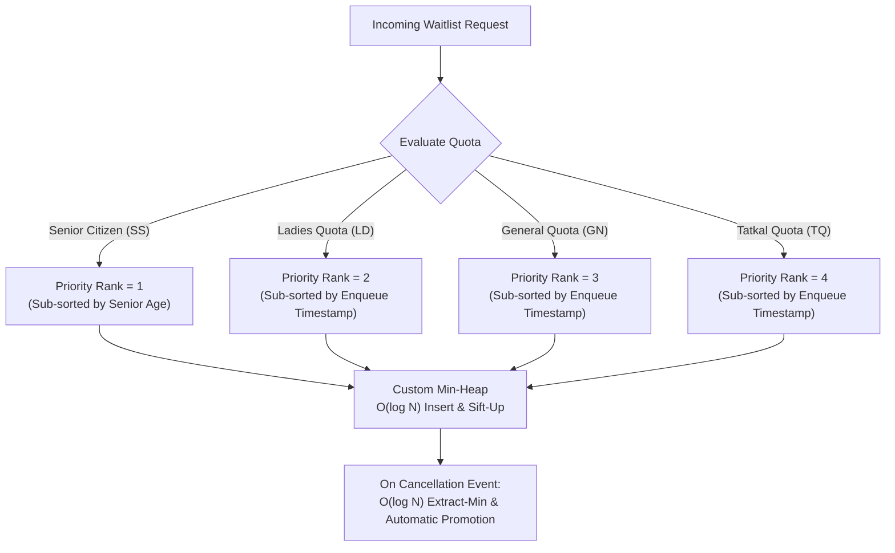

# Chapter 6: Reservation Quota Specification, Eligibility & Financial Rules

> **Scope:** General Quota (GN), Senior Citizen Category (SS), Ladies Quota (LD), and Tatkal Quota (TQ).  
> **Course / Subject:** Advanced Data Structures, Algorithms & Distributed Systems  
> **Module:** Domain Allocation Engine & Multi-Tier Financial Validation  

---

## 1. Executive Overview & Design Principles

In passenger rail networks (such as Indian Railways' CRIS/IRCTC architecture), berth allocation is not a naive uniform first-come-first-served (FCFS) queue. Instead, it operates across multiple **distinct reservation categories (quotas)**, each governed by:
1. **Strict Backend Eligibility Validation:** Client selections cannot be trusted. Passenger demographic attributes (age, gender, accompanying minors) must be verified cryptographically and structurally on the backend prior to seat holds.
2. **Specialized Technical Allocation:** Each quota interacts with tailored data structures—standard FIFO queues for General/Ladies, priority Min-Heaps for Senior Citizens, and isolated pools for short-notice Tatkal bookings.
3. **Independent Financial Calculations:** Selecting a quota on the client tier never alters the price client-side. The backend computes the authoritative fare using parameterized base rates and distance/class-based statutory surcharges.

---

## 2. Specification of the Four Reservation Categories

### 2.1 General Quota (GN)
* **Purpose:** The default reservation category for standard passengers without special demographic prerequisites.
* **Eligibility:** Any valid passenger aged **1 to 100 years**.
* **Technical Allocation:** Pure First-Come-First-Served (FCFS) ordering managed by an in-memory FIFO queue ($O(1)$ enqueue and dequeue operations). Tie-breaking uses the unique booking sequence counter.
* **Ordering Key:**
  $$\text{Key}_{\text{GN}} = (\text{booking\_timestamp}, \text{sequence\_id})$$
* **Financial Rules:** Standard base fare according to coach class (e.g., Sleeper: ₹250, 3AC: ₹850, 2AC: ₹1,200). Zero quota surcharge.

---

### 2.2 Senior Citizen / Lower-Berth Category (SS)
* **Purpose:** Provides demographic priority and prioritized lower-berth allocation for senior citizens and elderly passengers.
* **Eligibility Validation (Backend Enforced):**
  * **Male Passengers:** Must have $\text{Age} \ge 60$ years.
  * **Female Passengers:** Must have $\text{Age} \ge 58$ years.
  * Requests with non-senior passengers under this quota are rejected with `HTTP 400 Bad Request`.
* **Technical Allocation:**
  * **Lower-Berth Preference:** The allocation algorithm filters available coach berths, prioritizing `LOWER` berths for eligible senior passengers before falling back to middle/upper berths.
  * **Min-Heap Waiting List:** If berths are exhausted, passengers enter the multi-criteria Min-Heap with **Priority Rank 1 (Highest Priority)**.
* **Ordering Key:**
  $$\text{Key}_{\text{SS}} = (\text{Priority Rank} = 1, -\text{Age}, \text{timestamp}, \text{passenger\_id})$$
  *(Note: $-\text{Age}$ ensures older seniors receive promotion precedence within the senior tier).*
* **Financial Rules:** Standard base fare. (Note: In accordance with current railway rules, SS is an allocation category, not an automatic fare discount).

---

### 2.3 Ladies Quota (LD)
* **Purpose:** Dedicated accommodation category ensuring safe travel for solo female passengers and mothers with small children.
* **Eligibility Validation (Backend Enforced):**
  * Female passengers of any age ($\text{Gender} = \text{'F'}$).
  * Accompanied male children aged $\le 12$ years.
  * Adult male passengers ($\text{Age} > 12$) attempting to book under LD quota are strictly rejected with `HTTP 400 Bad Request`.
* **Technical Allocation:**
  * Managed under a dedicated quota pool with deterministic FIFO ordering.
  * Waitlist entries operate under **Priority Rank 2** in the promotion Min-Heap.
* **Ordering Key:**
  $$\text{Key}_{\text{LD}} = (\text{Priority Rank} = 2, \text{timestamp}, \text{sequence\_id})$$
* **Financial Rules:** Standard base fare. Zero quota surcharge.

---

### 2.4 Tatkal Quota (TQ)
* **Purpose:** Emergency, short-notice premium reservation category opening 24 hours prior to train departure from the originating station.
* **Eligibility & Booking Window:**
  * Validated against train originating schedule date.
  * Available across standard travel classes (2S, SL, CC, 3AC, 2AC, EC).
* **Technical Allocation:**
  * Dedicated Tatkal inventory pool.
  * Waitlist entries operate under **Priority Rank 4** (processed after senior and general waitlists unless an explicit Tatkal cancellation occurs).
* **Ordering Key:**
  $$\text{Key}_{\text{TQ}} = (\text{Priority Rank} = 4, \text{timestamp}, \text{sequence\_id})$$
* **Financial Rules (Dynamic Tatkal Surcharge Formula):**
  $$\text{Tatkal Charge} = \min\Big(\text{Max Charge}, \max\big(\text{Min Charge}, \text{Base Fare} \times \text{Rate}\big)\Big)$$
  $$\text{Total Fare} = \text{Base Fare} + \text{Tatkal Charge}$$

#### Statutory Rate & Ceiling Matrix

| Travel Class | Description | Rate (% of Base) | Minimum Surcharge | Maximum Surcharge |
| :--- | :--- | :---: | :---: | :---: |
| **2S** | Second Sitting | $10\%$ | ₹10 | ₹15 |
| **SL** | Sleeper Class | $10\%$ | ₹100 | ₹200 |
| **CC** | AC Chair Car | $30\%$ | ₹125 | ₹225 |
| **3AC** | AC 3-Tier | $30\%$ | ₹300 | ₹400 |
| **2AC** | AC 2-Tier | $30\%$ | ₹400 | ₹500 |
| **EC** | Executive Class | $30\%$ | ₹400 | ₹500 |

*Example Calculation for 2AC:*
* Base Fare = ₹1,200
* Raw Charge = $1,200 \times 0.30 = ₹360$
* Clamped between Min (₹400) and Max (₹500) $\to$ **Tatkal Charge = ₹400**
* Total Fare = $1,200 + 400 =$ **₹1,600 per passenger**.

---

## 3. Global Demographic Boundary: Maximum Age Limit (100 Years)

To protect the system against corrupt data, integer overflow attacks, and invalid input strings:
* **Pydantic Validation Schema:**
  ```python
  class PassengerCreate(BaseModel):
      age: int = Field(..., ge=1, le=100, description="Age must be between 1 and 100")
  ```
* **Frontend Clamping & Error Prevention:**
  Input fields enforce `min="1" max="100"` HTML bounds, and state handlers clamp typed input to $\max(1, \min(100, \text{parsed}))$.
* Submissions with ages $>100$ or $<1$ are blocked with `HTTP 422 Unprocessable Entity`.

---

## 4. Multi-Criteria Priority Min-Heap Implementation

When confirmed berths are exhausted, passengers enter an academic Min-Heap with the following deterministic priority hierarchy:



### Academic Complexity Invariants

| Operation | General (FIFO Queue) | Senior Citizen (Min-Heap) | Ladies (FIFO Queue) | Tatkal (Min-Heap Pool) |
| :--- | :---: | :---: | :---: | :---: |
| **Enqueue / Insert** | $O(1)$ | $O(\log N)$ | $O(1)$ | $O(\log N)$ |
| **Dequeue / Promotion** | $O(1)$ | $O(\log N)$ | $O(1)$ | $O(\log N)$ |
| **Peek Next Eligible** | $O(1)$ | $O(1)$ | $O(1)$ | $O(1)$ |

---

## 5. Separation of Concerns & Financial Integrity

1. **Client Independence:** The client UI only requests a seat hold with passenger attributes and desired quota.
2. **Backend Authority:** The backend calculates `base_fare`, `tatkal_charge`, and `total_fare` independently using the coach configuration and quota specifications.
3. **Auditability:** All financial breakdowns are stored in persistent payment records and returned in the `fare_breakdown` JSON response structure.
