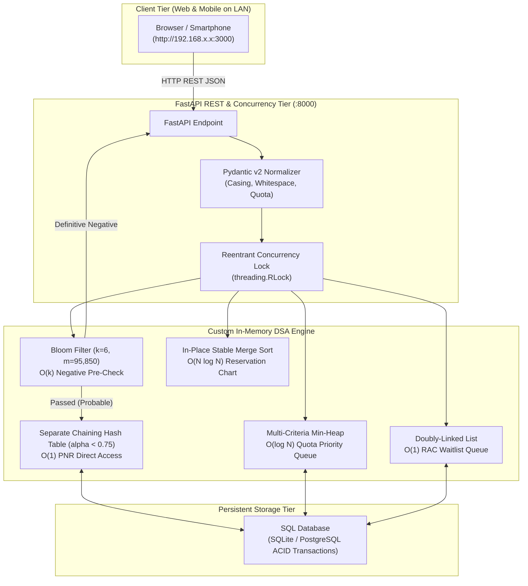

# Railway Reservation System: Academic Book of Documentation (DSA & Systems Engineering)

> **College Final Year / Major DSA Project Handbook**  
> **Course / Subject:** Advanced Data Structures, Algorithms & Distributed Systems  
> **Repository:** `Debanjan110d/Railway-Reservation-System`

---

## Abstract & Executive Summary

Modern high-concurrency reservation systems (such as Indian Railways' IRCTC or airline reservation networks) encounter severe algorithmic and systems-engineering bottlenecks during peak traffic (e.g., *Tatkal* booking rushes). Standard relational database patterns relying solely on SQL indexing, row-level locks, and polling suffer from connection-pool starvation, locking deadlocks, cache-miss latency, and unscalable $O(N)$ priority queue re-evaluations during booking cancellations.

This project implements a complete, production-grade **Railway Reservation Engine** engineered from first principles around custom academic Data Structures and Algorithms (zero built-in library shortcuts). It couples an in-memory high-throughput DSA core with a FastAPI Python asynchronous backend and a Next.js 16 (React 19 + Tailwind CSS) client.

This **Book of Documentation** details the exact real-world engineering problems encountered during design and development, the mathematical models and custom algorithms developed to solve them, and empirical verification under heavy parallel load.

---

## Table of Contents (Book Chapters)

| Chapter | Document Title | Primary Topics & Theoretical Formulations |
| :--- | :--- | :--- |
| **Ch. 1** | [**01. Problem Analysis & Real-World Challenges**](01_PROBLEM_ANALYSIS_AND_CHALLENGES.md) | The *Tatkal* flash-crowd problem, double-allocation race conditions, waitlist starvation, SQL lock contention, memory leaks, LAN cross-device networking traps. |
| **Ch. 2** | [**02. Custom DSA Formulations & Solutions**](02_CUSTOM_DSA_SOLUTIONS.md) | In-memory Polynomial Rolling Hash Table, Kirsch-Mitzenmacher Bloom Filter pre-checker, Multi-Criteria Quota Min-Heap, Doubly-Linked Circular RAC Queue, Stable Merge-Sort. |
| **Ch. 3** | [**03. Concurrency, Parallel Processing & Normalization**](03_CONCURRENCY_AND_PARALLEL_PROCESSING.md) | Reentrant Thread Locking (`threading.RLock`), 2-Phase Seat Hold with 5-minute TTL, Idempotency Tokens, Casing/Whitespace normalization, Deadlock-free invariants. |
| **Ch. 4** | [**04. Local Area Network (LAN) & Cross-Device Engineering**](04_LAN_DEPLOYMENT_AND_CROSS_DEVICE_NETWORKING.md) | Cross-device routing, dynamic LAN IP socket auto-detection, `NEXT_PUBLIC_API_URL` client-side hydration fix, CORS and firewall configuration. |
| **Ch. 5** | [**05. Empirical Benchmark Results & Viva Voce Guide**](05_EXPERIMENTAL_RESULTS_AND_VIVA_PREP.md) | Asymptotic complexity proofs ($O(1)$, $O(\log N)$), 1,200-event stress test benchmarks, and 15 rigorous Examiner/Professor Viva Q&A with answers. |
| **Ch. 6** | [**06. Reservation Quotas & Financial Rules**](06_RESERVATION_QUOTA_SPECIFICATION_AND_FINANCIAL_RULES.md) | GN, SS, LD, and TQ technical allocation, backend demographic validation, statutory Tatkal surcharge formula, and max 100-year age limit. |

---

## Architectural Workflow Overview

---

## Academic Attribution & Verification

- **Language & Runtime:** Python 3.11+ / Node.js 20+
- **Unit & Integration Suite:** 22 automated pytest test cases (`backend/app/tests/`)
- **Frontend Engine:** Next.js 16 with Turbopack compilation ($<700\text{ms}$)
- **Mathematical Formulations:** Polynomial Rolling Hash, FNV-1a, Kirsch-Mitzenmacher Bloom optimization, Binary Heap Sifting, Stable Divide-and-Conquer Merge.

